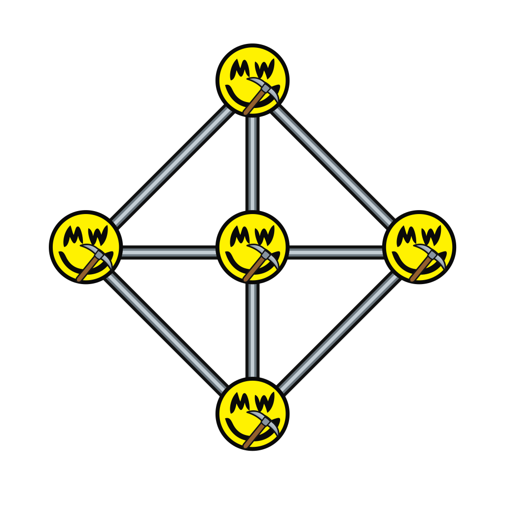

<div align="center">
    

  <a href="https://github.com/G2Pool/G2Pool">G2Pool: P2Pool implementation for Grin</a>
</div>

## G2Pool

G2Pool is a non-custodial, peer-to-peer mining pool for Grin, heavily inspired by [Monero P2Pool](https://github.com/SChernykh/p2pool).

Unlike Monero P2Pool, Grin cannot pay contributors through a simple address list. G2Pool prepares payout coupons in each job. When a proof wins, the complete payout construction is already part of the Grin block, so there is no payout coordination after the win.

## How to use

Install:

```sh
cargo install --path . --locked
```

Start a mainnet instance:

```sh
g2pool
```

Point the miners on this machine at the local Stratum listener:

```text
127.0.0.1:3420
```

G2Pool peers listen on `3417` for mainnet and `13417` for testnet by default. Make them reachable if you want them to accept inbound peers.

Check the daemon status:

```sh
g2pool status
```

Withdraw your accumulated reward:

```sh
g2pool withdraw
```
